<!-- Profile README for github.com/Prajwalpjoshi. Card graphics live in ./assets (light + dark variants). -->

<picture>
  <source media="(prefers-color-scheme: dark)" srcset="assets/dark/hero-title.svg">
  
</picture>

<picture>
  <source media="(prefers-color-scheme: dark)" srcset="assets/dark/hero-title.svg">
  
</picture>

I turn engineering problems into reliable software. I build full-stack applications, backend APIs and test automation, with a particular interest in caching, performance and cloud-ready delivery.

<a href="https://prajwal-joshi.onrender.com"><picture><source media="(prefers-color-scheme: dark)" srcset="assets/dark/btn-portfolio.svg"></picture></a>
<a href="https://www.linkedin.com/in/prajwal-joshi-a67460271/"><picture><source media="(prefers-color-scheme: dark)" srcset="assets/dark/btn-linkedin.svg"></picture></a>
<a href="https://github.com/Prajwalpjoshi?tab=repositories"><picture><source media="(prefers-color-scheme: dark)" srcset="assets/dark/btn-github.svg"></picture></a>

 

<h3> What I Build</h3>

<picture><source media="(prefers-color-scheme: dark)" srcset="assets/dark/build-backend.svg">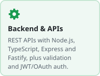</picture>
<picture><source media="(prefers-color-scheme: dark)" srcset="assets/dark/build-caching.svg">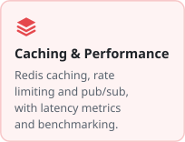</picture>
<picture><source media="(prefers-color-scheme: dark)" srcset="assets/dark/build-automation.svg">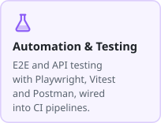</picture>
<picture><source media="(prefers-color-scheme: dark)" srcset="assets/dark/build-cloud.svg"></picture>

<h3> Featured Project</h3>

<a href="https://github.com/Prajwalpjoshi/cacheforge"><picture><source media="(prefers-color-scheme: dark)" srcset="assets/dark/featured-cacheforge.svg">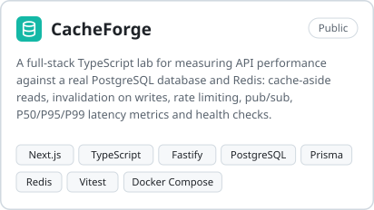</picture></a>
<a href="https://cacheforge.netlify.app/">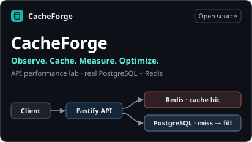</a>

<a href="https://github.com/Prajwalpjoshi/cacheforge"><picture><source media="(prefers-color-scheme: dark)" srcset="assets/dark/link-view-github.svg"></picture></a>
&nbsp;
<a href="https://cacheforge.netlify.app/"><picture><source media="(prefers-color-scheme: dark)" srcset="assets/dark/link-live-demo.svg"></picture></a>

<h3> Currently Exploring (Learning / In Progress)</h3>

<picture><source media="(prefers-color-scheme: dark)" srcset="assets/dark/explore-redis.svg">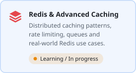</picture>
<picture><source media="(prefers-color-scheme: dark)" srcset="assets/dark/explore-distributed.svg">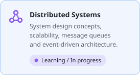</picture>
<picture><source media="(prefers-color-scheme: dark)" srcset="assets/dark/explore-ai.svg"></picture>

<h3> Tech Stack</h3>

<picture><source media="(prefers-color-scheme: dark)" srcset="assets/dark/tech-languages.svg">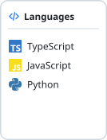</picture>
<picture><source media="(prefers-color-scheme: dark)" srcset="assets/dark/tech-frontend.svg">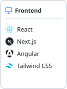</picture>
<picture><source media="(prefers-color-scheme: dark)" srcset="assets/dark/tech-backend.svg">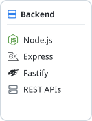</picture>
<picture><source media="(prefers-color-scheme: dark)" srcset="assets/dark/tech-data.svg">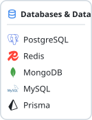</picture>
<picture><source media="(prefers-color-scheme: dark)" srcset="assets/dark/tech-testing.svg">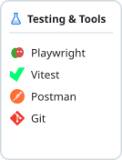</picture>
<picture><source media="(prefers-color-scheme: dark)" srcset="assets/dark/tech-devops.svg"></picture>

<h3> GitHub Activity</h3>

<picture><source media="(prefers-color-scheme: dark)" srcset="https://github-readme-stats.vercel.app/api?username=Prajwalpjoshi&show_icons=true&hide_rank=true&hide_border=true&theme=github_dark&bg_color=0d1117&cache_seconds=86400"></picture>
<picture><source media="(prefers-color-scheme: dark)" srcset="https://github-readme-stats.vercel.app/api/top-langs/?username=Prajwalpjoshi&layout=compact&langs_count=6&hide_border=true&theme=github_dark&bg_color=0d1117&cache_seconds=86400"></picture>
<picture><source media="(prefers-color-scheme: dark)" srcset="https://streak-stats.demolab.com/?user=Prajwalpjoshi&hide_border=true&theme=dark&background=0d1117"></picture>

---

Bengaluru, India ·
<a href="https://www.linkedin.com/in/prajwal-joshi-a67460271/">LinkedIn</a> ·
<a href="mailto:prajwaljoshi1856@gmail.com">prajwaljoshi1856@gmail.com</a> ·
<a href="https://github.com/Prajwalpjoshi/cacheforge">CacheForge</a>
 
Open to Software Engineer, Full-Stack, Backend and developer-tools roles.

